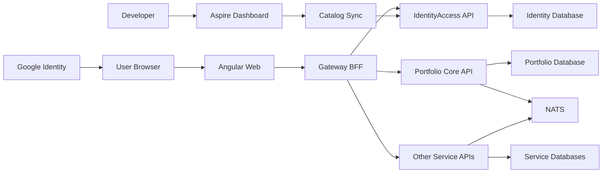

# LedgerLens Identity, Access, and UI Resource Threat Model

Last reviewed: 2026-09-23. Scope: current repository plus the proposed plan 0006 target design. No proposed authentication control is current runtime behavior.

## Executive summary

LedgerLens currently relies on a fixed local user and loopback isolation, so accidental non-loopback exposure or a hostile local/browser origin can reach financial APIs without real authentication. The proposed Google OIDC, Gateway BFF, IdentityAccess service, role administration, and UI resource sync reduce that risk only if three boundaries remain strict: Google credentials terminate at the Gateway, every internal API independently validates an audience-bound LedgerLens identity while retaining owner predicates, and catalog/role administration cannot implicitly grant privilege. The highest-priority target-design risks are cross-user financial access, forged internal identity, administrator privilege escalation, session/signing-key theft, and unsafe resource-catalog synchronization.

## Scope and assumptions

In scope:

- Angular browser application under `web/ledgerlens-web/`;
- YARP Gateway and AppHost under `src/LedgerLens.Gateway/` and `src/LedgerLens.AppHost/`;
- Portfolio Core current-user and owner enforcement under `src/Services/PortfolioCore/`;
- proposed IdentityAccess, Google OIDC, session, TOTP MFA/step-up, security dashboard, role/group, resource catalog, translation, and internal-token designs in `docs/architecture/IDENTITY_ACCESS_AND_UI_LOCALIZATION.md`, `docs/architecture/SESSION_AND_MFA_ADMINISTRATION.md`, `docs/architecture/ACCESS_ADMINISTRATION_AND_RESOURCE_CATALOG.md`, and plan 0006;
- PostgreSQL service databases, NATS, Aspire Dashboard/resource commands, configuration, logging, tests, and migration tooling where they affect identity/access trust.

Out of scope:

- Gmail or other Google API access, delegated OAuth grants, additional identity providers, live trading, AI, and public/LAN deployment implementation;
- vulnerabilities inside Google infrastructure, PostgreSQL, NATS, browsers, or the operating system that do not depend on LedgerLens configuration;
- final production-host threat ranking before a hosting environment exists.

Assumptions affecting ranking:

- The first implementation remains loopback-only. Internet exposure is a future gate; exposing the current application would raise several threats to critical.
- Financial holdings, transaction history, account metadata, identity mappings, permissions, and audit records are high-sensitivity data even for one owner.
- Registration is closed; the existing owner is linked to Google through an explicit exact-UUID migration, not email matching.
- Role/Group membership is the primary authorization mechanism; per-user overrides are exceptional and audited.
- IdentityAccess, 30-minute idle/eight-hour absolute sessions, and 60-second audience-bound internal tokens remain proposed until owner acceptance.
- A host/OS compromise can read process memory or act as the user and is not fully mitigated by application controls; the model still includes prevention of accidental local cross-origin and lower-privileged process access.

Open questions that can materially change risk:

- Whether a future deployment will be Internet-facing, LAN-only, or remain personal localhost-only.
- Whether more than one trusted administrator exists; last-admin recovery is harder for a single-owner system.
- Which production key store, reverse proxy, and backup-encryption mechanism will be selected.
- Which MFA framework path, security-event retention period, recently-active window, and privacy-safe client summary are accepted.

## System model

### Primary components

- Angular 22 SPA: current monolithic shell; proposed login, guards, auth store, Administration pages, page bootstrap, and typed resource keys (`web/ledgerlens-web/src/app/`).
- Gateway/BFF: current YARP routing; proposed Google verification, cookie authentication, antiforgery, session validation, authorization, header stripping, and internal-token issuance (`src/LedgerLens.Gateway/Program.cs`, `GatewayRoutes.cs`).
- IdentityAccess: proposed internal service/database for identities, sessions, MFA credentials/recovery codes, roles, grants/overrides, resource catalog, translations, and security audit (`docs/architecture/IDENTITY_ACCESS_AND_UI_LOCALIZATION.md`).
- Portfolio Core: implemented service-local user profile, `ICurrentUser`, `Portfolio.OwnerUserId`, and owner-filtered stores (`src/Services/PortfolioCore/`).
- Other business services: Gateway-routed internal APIs for Market Data, Slip Import, Research, and Operations (`src/LedgerLens.Gateway/GatewayRoutes.cs`).
- AppHost/Aspire Dashboard: current orchestration and secrets parameters; proposed local catalog-sync resource commands (`src/LedgerLens.AppHost/Program.cs`).
- PostgreSQL/NATS: internal state and messaging resources, with service-owned databases (`docs/architecture/ASPIRE_TOPOLOGY.md`).
- Google Identity Services: proposed external OIDC identity provider; no delegated API token storage.

### Data flows and trust boundaries

- Browser → Angular/Gateway: cookies, antiforgery token, Google ID token during login, API JSON, language preference, admin mutations; HTTP on explicit loopback Development and HTTPS for any future deployment; proposed exact Origin/Referer, content type/body limits, CSRF, CSP, rate limiting, authentication, and authorization.
- Google → Browser → Gateway: signed ID token with issuer, subject, audience, expiry, email/profile claims, and nonce; proposed server verification and immediate browser discard.
- Gateway → IdentityAccess: verified minimal login assertion, session introspection/revocation, access administration, and page/catalog queries over internal HTTP; proposed short-lived service/user tokens with exact audience and permission.
- Gateway → business API: JSON plus a short-lived signed internal user token; YARP must strip browser cookie, Authorization, and identity headers; each API validates issuer/signature/audience/lifetime.
- Business API → service database: domain state and owner-filtered SQL through EF Core; service-owned credentials and reviewed migrations.
- Developer/administrator → Angular Administration UI: security dashboard/session inventory, MFA reset/policy, role membership, permission matrix, overrides, resource publication, translations, session revocation, and audit queries; proposed strong permissions, recent MFA step-up, version checks, self-lockout controls, and CSRF.
- Developer → Aspire Dashboard/CLI → catalog sync: source-controlled manifest, preview hash, explicit apply confirmation, and bounded diff output; Development/deployment identity only.
- Services ↔ NATS: future at-least-once integration events; no browser credential or reusable auth token belongs in messages/logs.

#### Diagram

## Assets and security objectives

| Asset | Why it matters | Security objective (C/I/A) |
| --- | --- | --- |
| Portfolio/ledger/account data | financial privacy and correctness; wrong mutation can corrupt reconciliation | C/I/A |
| Internal UUIDv7 owner identity | joins authentication to financial ownership | C/I |
| External identity mapping | controls which Google account becomes which internal owner | C/I |
| Session records/cookies | allow browser access and revocation | C/I/A |
| MFA credentials, recovery codes, and pre-authentication transactions | control the second factor and account recovery | C/I/A |
| Internal signing private key and Data Protection keys | compromise enables forged identities or cookie decryption | C/I/A |
| Roles, memberships, grants, and overrides | determine access to every menu/page/action/API | I/A |
| UI resource manifest/catalog/translations | connects source actions to runtime authorization and user-visible meaning | I/A |
| Google client/runtime configuration | audience/origin mistakes can admit the wrong client | I/A |
| Security audit events | support attribution and incident reconstruction | I/A |
| Backups and migration artifacts | recovery can reintroduce secrets or wrong ownership | C/I/A |
| Logs/traces | may leak tokens/PII and are needed for detection | C/I/A |

## Attacker model

### Capabilities

- Operate a hostile website that causes a logged-in browser to make cross-origin requests.
- Modify browser requests, Angular state, routes, hidden controls, headers, and payloads.
- Present forged, expired, wrong-audience, or stolen Google/internal tokens.
- Authenticate as an ordinary allowed user and enumerate or alter identifiers to target another owner.
- Abuse a compromised or over-privileged access administrator to change roles, overrides, translations, sessions, or catalog state.
- Submit a malicious or erroneous catalog manifest if a developer/deployment credential is compromised.
- Run a lower-privileged local process that probes exposed loopback ports; future Internet attackers gain comparable network reach if exposure is later allowed.

### Non-capabilities

- No assumed control of the host OS, browser process, Google signing keys, Gateway private signing key, Data Protection key ring, PostgreSQL superuser, or trusted build pipeline.
- No assumed direct network reach to internal services/databases when AppHost exposure rules hold.
- No assumed administrator or developer credential unless a threat explicitly models its compromise.
- No Gmail/API authorization token exists in the proposed first slice.

## Entry points and attack surfaces

| Surface | How reached | Trust boundary | Notes | Evidence (repo path / symbol) |
| --- | --- | --- | --- | --- |
| Current `/api/*` Gateway routes | browser/HTTP | browser to Gateway to API | currently no auth; loopback/origin controls are the boundary | `src/LedgerLens.Gateway/GatewayRoutes.cs`; `README.md` |
| Proposed `/auth/google` and `/auth/session` | browser/HTTP | Google/browser to Gateway | credential, nonce, audience, CSRF, rate limit, session creation | `docs/architecture/IDENTITY_ACCESS_AND_UI_LOCALIZATION.md` |
| Proposed Administration APIs | Angular through Gateway | administrator to IdentityAccess | user status, role membership, grants, overrides, sessions, translations | `docs/architecture/ACCESS_ADMINISTRATION_AND_RESOURCE_CATALOG.md` |
| Proposed MFA and Security Dashboard APIs | Angular through Gateway | user/administrator to Gateway/IdentityAccess | TOTP enrollment/verification/recovery/reset, session counts/expiry/revocation | `docs/architecture/SESSION_AND_MFA_ADMINISTRATION.md` |
| Page bootstrap/navigation | Angular through Gateway | user to IdentityAccess | permission/text version and cache correctness | `docs/architecture/IDENTITY_ACCESS_AND_UI_LOCALIZATION.md` |
| Catalog sync commands | local Dashboard/CLI | developer to AppHost to IdentityAccess | preview/apply hash, manifest, default-deny lifecycle | `docs/architecture/ACCESS_ADMINISTRATION_AND_RESOURCE_CATALOG.md`; `src/LedgerLens.AppHost/Program.cs` |
| Portfolio identifiers and commands | Gateway/internal HTTP | authenticated user to Portfolio Core | ownership filters must cover every path | `PortfolioCoreStore.cs`; `ICurrentUser.cs` |
| Fixed-user options | AppHost parameters/environment | operator config to Portfolio Core | current identity authority; private runtime data | `src/LedgerLens.AppHost/Program.cs`; `FixedLocalUserOptions.cs` |
| PostgreSQL migrations/backups | maintenance tooling | operator to service database | identity/owner/schema integrity and secret handling | `docs/architecture/HYBRID_DATABASE_WORKFLOW.md`; `BACKUP_AND_RESTORE.md` |
| Logs/traces/Dashboard | local operational UI | services to developer | must redact auth/PII and remain loopback-only | `docs/architecture/OBSERVABILITY.md`; `ASPIRE_TOPOLOGY.md` |

## Top abuse paths

1. Attacker obtains or fabricates a Google credential → bypasses issuer/audience/nonce/email checks → links to an existing internal owner → reads or mutates financial data.
2. Hostile site triggers login or state-changing requests in the victim browser → cookie is sent automatically → attacker fixes the victim session or changes ledger/access state without antiforgery/origin validation.
3. Browser supplies `X-User-Id`, cookie, or Authorization header → Gateway forwards it unchanged → internal API treats it as trusted → attacker impersonates another UUIDv7 owner.
4. Ordinary user changes a portfolio/account identifier → an endpoint omits or applies ownership filtering after materialization → User A receives or modifies User B data.
5. Access administrator grants `administration.roles.manage` or a financial action to themselves/another account → stale or missing version/self-lockout rules permit privilege escalation → sessions immediately gain broader authority.
6. Compromised developer adds a key resembling a legitimate button → catalog sync auto-activates or auto-grants it → hidden backend capability becomes usable without independent review.
7. Stale Administration tab replaces a newer role matrix → removed denies or grants reappear → permissions diverge from the reviewed state.
8. Gateway signing/Data Protection key leaks through Git, logs, backup, or permissive file ACL → attacker forges internal tokens or session cookies → all service authorization and ownership subjects become suspect.
9. Stored translation contains executable markup → administrator publishes it → Angular renders unsafe HTML → attacker executes actions as a privileged user despite HttpOnly cookies.
10. Attacker abuses MFA enrollment/reset/recovery or replays a TOTP → upgrades a primary-only or stolen session → performs high-risk administration as the victim.
11. Over-broad dashboard response or misleading presence logic exposes credential/PII metadata or labels a stale session as online → enables targeting and false incident conclusions.

## Threat model table

| Threat ID | Threat source | Prerequisites | Threat action | Impact | Impacted assets | Existing controls (evidence) | Gaps | Recommended mitigations | Detection ideas | Likelihood | Impact severity | Priority |
| --- | --- | --- | --- | --- | --- | --- | --- | --- | --- | --- | --- | --- |
| TM-001 | remote/local unauthenticated caller | Current Gateway/API reachable | Calls current business APIs under fixed identity or after accidental non-loopback exposure | Full owner impersonation and financial disclosure/mutation | portfolio data, owner identity | Loopback-only policy and Origin/content-type controls (`README.md`, `SECURITY_AND_PRIVACY.md`) | no real authentication today | keep every endpoint loopback-only until plan 0006 gates pass; fail startup on unsafe binding; add BFF auth before any exposure | binding/config audit, anonymous request metrics, startup security event | medium locally; high if exposed | high | critical if exposed; high locally |
| TM-002 | forged credential or login-CSRF attacker | Can reach proposed login endpoint | Replays/wrong-audience token or fixes victim login | Maps attacker identity to victim session/account | external mapping, sessions, portfolio | proposed Google validation and unique issuer/subject (ADR-0019) | not implemented; bootstrap/link flow sensitive | official verifier, exact audience/issuer/expiry/nonce, verified-email policy, antiforgery/origin, closed registration, exact-UUID owner link | safe login failure codes, rate-limit metrics, duplicate-link alerts | medium | high | high |
| TM-003 | malicious browser/direct API caller | Internal service reachable or Gateway transform weak | Injects identity headers/cookie/wrong-audience token | impersonation or privilege escalation | owner identity, permissions, financial data | current owner predicates (`PortfolioCoreStore.cs`); proposed ADR-0020 | current services accept fixed user; no internal token validation | strip credentials at YARP; asymmetric short token; exact audience; service fallback auth; no direct external endpoints | 401 reason metrics without token, wrong-audience alerts, direct-service probes | medium | high | high |
| TM-004 | authenticated user | Knows/guesses another UUID and finds one incomplete path | Calls read/write endpoint lacking pre-materialization owner predicate | cross-user financial disclosure/mutation | portfolio/ledger/account data | many implemented owner filters (`PortfolioCoreStore.cs`); required architecture rule | coverage must remain complete as endpoints grow | endpoint capability plus owner predicate; query before count/materialization; two-user contract/distributed tests for every operation | forbidden/not-found anomaly, owner mismatch audit without values | medium | high | high |
| TM-005 | compromised/over-privileged administrator | Has some administration access | Changes role membership, overrides, status, or sessions to obtain stronger rights | broad account/financial access and lockout | roles, users, sessions, audit | proposed default deny, explicit precedence, audit (ADR-0021) | admin UI/API not implemented; circular authorization risk | split view/manage/publish/sync permissions; last-admin rules; expected versions; reason/audit; reauthentication for critical changes; immediate invalidation | privileged-change alerts, self-grant/last-admin events, permission-version changes | medium | high | high |
| TM-006 | compromised developer/build/deployment identity | Can alter manifest or execute sync | Imports typo/malicious resource, silently drops/renames grants, or auto-activates key | privilege escalation or access outage | catalog, grants, translations | proposed source control, Draft/default deny, review (`ACCESS_ADMINISTRATION_AND_RESOURCE_CATALOG.md`) | tooling not implemented; Aspire API/version compatibility pending | schema/static checks; preview hash; transactional idempotent apply; no hard delete; explicit rename; local/deployment identity only; protected branch review | manifest hash/audit correlation, unexpected Draft/retirement counts, sync failures | medium | high | high |
| TM-007 | hostile website/XSS payload | User has active cookie | Sends unsafe method or runs same-origin script to perform privileged action | financial/access mutation | sessions, roles, portfolio data | proposed HttpOnly/SameSite cookie, Angular encoding, CSP, antiforgery | controls not implemented; XSS can act as user | Angular XSRF + server antiforgery; exact origin; CSP; text-only translations; no unsafe HTML; reauth for critical admin operations | CSRF failures, CSP reports, unusual admin mutation sequences | medium | high | high |
| TM-008 | key thief or malicious operator/process | Reads private key ring, logs, backup, or process config | Forges session/internal token or prevents rotation | system-wide impersonation and outage | signing keys, sessions, all protected data | repository secret policy and external runtime boundary (`REPOSITORY_SAFETY_PLAN.md`, ADR-0010) | production key store/rotation not selected | separate signing/Data Protection keys; ACL/managed store; rotation overlap/revocation; encrypted backups; secret/log scans; never return keys from commands | key access audit, rotation metrics, signature-kid anomalies, emergency revocation runbook | low to medium | high | high |
| TM-009 | stale cache/tab or availability failure | Permission/translation changed or IdentityAccess unavailable | Old allow remains usable or system falls open | unauthorized action or inconsistent UI/API | permissions, sessions, catalog | proposed versioned page bootstrap/internal tokens | exact cache TTL/invalidation not implemented | fail closed; explicit permission/security version; immediate deny/status invalidation; optimistic concurrency; 60-second maximum internal token | stale-version rejection metrics, cache invalidation failures, denied-after-change tests | medium | medium to high | high |
| TM-010 | malicious translation editor/content | Can edit UI text | Stores HTML/script or deceptive security label | XSS or administrator/user deception | sessions, UI integrity, audit | Angular output encoding is expected; proposed text fields | rich-text policy not implemented | plain text only, length/character policy, no innerHTML, preview encoding, separate permission from label, audit/publish review | CSP reports, translation change audit, HTML marker rejection | low to medium | high | medium |
| TM-011 | account attacker or compromised administrator | Can reach MFA enrollment/reset/recovery/verification | Registers attacker credential, replays TOTP, consumes recovery code, bypasses step-up, or resets victim MFA | account takeover and privileged changes | MFA credentials, sessions, roles, portfolio | proposed restricted pre-auth, recent step-up and audit (`SESSION_AND_MFA_ADMINISTRATION.md`) | framework path and controls not implemented | proof-before-activation; cookie rotation; rate limit/lockout; timestep replay record; slow-hashed one-time recovery; recent-MFA reset; all-session revocation; deterministic tests | enrollment/reset/recovery alerts, repeated-code rejection, lockout and step-up-failure metrics | medium | high | high |
| TM-012 | over-privileged viewer or faulty presence logic | Has dashboard access or receives over-broad DTO | Enumerates sensitive session/client data or treats stale activity as exact online status | privacy leak, user targeting, false response actions | sessions, identity metadata, audit | proposed exact view keys and redaction (`SESSION_AND_MFA_ADMINISTRATION.md`) | dashboard not implemented; retention/freshness undecided | separate active/recent; bounded/coalesced activity; omit tokens/secrets/raw IP/full user agent; pagination; retention; audit dashboard access | unusual enumeration/export volume, privacy contract tests, count reconciliation | medium | medium to high | high |

## Criticality calibration

- **Critical:** credible complete bypass of owner isolation or signing-key compromise under the deployed exposure model. Examples: public unauthenticated fixed-user API; forged Gateway tokens accepted by all services; Google link mapped to the existing owner without proof.
- **High:** realistic cross-user disclosure/mutation, administrator privilege escalation, CSRF of financial/admin operations, or catalog sync that activates a new capability. Examples: missing owner predicate; self-grant through role management; leaked session key with bounded reach.
- **Medium:** integrity or availability failures requiring a privileged editor or limited precondition, without direct financial owner bypass. Examples: deceptive translation, bounded catalog outage, noisy login denial of service.
- **Low:** low-sensitivity metadata disclosure or easily detected local-only failure with no authorization effect. Examples: non-sensitive resource-key enumeration or a rejected stale preview with no write.

Internet exposure, multiple untrusted tenants, or external API clients raise likelihood and may elevate TM-001, TM-002, TM-003, TM-005, TM-007, and TM-008 by one level.

## Focus paths for security review

| Path | Why it matters | Related Threat IDs |
| --- | --- | --- |
| `src/LedgerLens.Gateway/Program.cs` | future cookie/auth/antiforgery middleware ordering and fallback policy | TM-001, TM-002, TM-007 |
| `src/LedgerLens.Gateway/GatewayRoutes.cs` | public route authorization and credential-stripping/internal-token transforms | TM-003, TM-009 |
| `src/LedgerLens.AppHost/Program.cs` | exposure, secret parameters, fixed ports, IdentityAccess and catalog commands | TM-001, TM-006, TM-008 |
| `src/Services/PortfolioCore/LedgerLens.PortfolioCore.Application/ICurrentUser.cs` | transition from fixed to trusted claims-backed user | TM-003, TM-004 |
| `src/Services/PortfolioCore/LedgerLens.PortfolioCore.Infrastructure/FixedLocalCurrentUser.cs` | current global impersonation boundary and removal gate | TM-001, TM-003 |
| `src/Services/PortfolioCore/LedgerLens.PortfolioCore.Infrastructure/PortfolioCoreStore.cs` | implemented owner predicates across financial reads/writes | TM-004 |
| `web/ledgerlens-web/src/app/app.config.ts` | future XSRF/interceptor configuration | TM-007, TM-009 |
| `web/ledgerlens-web/src/app/app.routes.ts` | future auth/permission guards and administration routes | TM-005, TM-009 |
| `docs/architecture/IDENTITY_ACCESS_AND_UI_LOCALIZATION.md` | proposed identity/session/token/key controls requiring implementation parity | TM-002, TM-003, TM-008 |
| `docs/architecture/ACCESS_ADMINISTRATION_AND_RESOURCE_CATALOG.md` | proposed role/catalog/sync lifecycle and lockout controls | TM-005, TM-006, TM-009, TM-010 |
| `docs/architecture/SESSION_AND_MFA_ADMINISTRATION.md` | proposed MFA, step-up, session presence/expiry, revocation and dashboard privacy controls | TM-005, TM-007, TM-009, TM-011, TM-012 |
| `tests/LedgerLens.DistributedAppTests/FoundationConnectivityTests.cs` | future complete two-user/spoof/direct-service distributed evidence | TM-001, TM-003, TM-004 |
| `tests/LedgerLens.Gateway.IntegrationTests/GatewayRouteTests.cs` | route auth, localization, headers, cookie and failure behavior | TM-002, TM-003, TM-007 |

## Quality check

- Current and proposed entry points are separated and covered.
- Every browser, provider, Gateway/service, database, administration, and developer-sync trust boundary appears in at least one threat.
- Runtime behavior is separated from local AppHost/Dashboard tooling and tests.
- User clarification about full role/group administration, frontend-key database synchronization, session visibility, expiry/revocation, and two-factor authentication is reflected.
- Unconfirmed deployment, administrator count, key store, and session/token defaults remain explicit assumptions rather than implemented facts.
